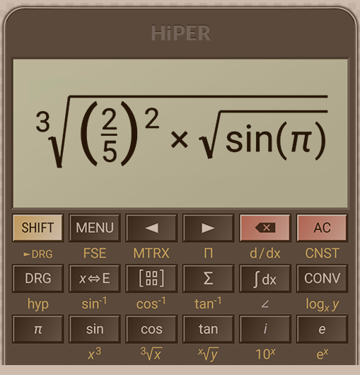

# RK Calculator 🧮✨



A professional, feature-rich, and lightning-fast **Advanced Scientific & Mathematical Calculator** built with Flutter and Dart. Designed with Material Design 3, RK Calculator features a stunning Dark/Light mode interface, precision calculation engine, and comprehensive mathematical modules.

---

## 📥 Download APK

Get the latest stable release of RK Calculator for Android:

👉 **[Download RK Calculator v1.0.0 (Release APK)](https://github.com/YOUR_GITHUB_USERNAME/RK-Calculator/releases/latest/download/app-release.apk)**

---

## 🚀 Key Features

### 1. 🧮 Basic & Scientific Calculator
- **Basic Operations**: Addition (`+`), Subtraction (`−`), Multiplication (`×`), Division (`÷`), Percentage (`%`), Decimals, Parentheses `( )`.
- **Advanced Scientific Functions**: Trigonometric (`sin`, `cos`, `tan`), Inverse Trig (`sin⁻¹`, `cos⁻¹`, `tan⁻¹`), Hyperbolic (`sinh`, `cosh`, `tanh`), Logarithms (`log`, `ln`, `log₂`, arbitrary-base `logₓy`), Powers & Roots (`x²`, `x³`, `x^y`, `√`, `∛`, nth root), Factorials (`x!`), Permutations (`nPr`), Combinations (`nCr`), Absolute Value (`|x|`), Reciprocals (`1/x`), Modulo (`mod`), and Constants (`π`, `e`).
- **Angle Modes**: Instant toggle between **DEG** (Degrees) and **RAD** (Radians).

### 2. 🔢 Advanced Mathematical Modules
- **Matrix Calculator**: 2×2 and 3×3 matrix operations including Addition, Subtraction, Multiplication, Determinant, Inverse, and Transpose.
- **Statistical Calculator (STAT)**: Dataset analysis computing Count ($n$), Sum ($\Sigma x$), Sum of Squares ($\Sigma x^2$), Mean, Median, Mode, Variance, Standard Deviation, Min, and Max.
- **Complex Number Calculator**: Real and imaginary components (`i`), complex arithmetic, conjugate, modulus, and argument.
- **Calculus Functions**: Numerical integration (Simpson's rule), numerical differentiation, summation ($\Sigma$), and limits ($\lim$).
- **Fraction Calculator**: Rational fraction input, decimal conversions, simplification, and exact arithmetic.
- **Unit Converter (CONV)**: Built-in scientific conversions for Length, Mass, Volume, and Speed.

### 3. 🎨 Modern UI/UX
- **Material Design 3**: Clean, minimalist, and responsive layout supporting portrait and landscape orientations.
- **Theme Switcher**: Premium Dark Mode (`#0B0F19`) and Clean Light Mode (`#F1F5F9`).
- **Haptic Feedback & Smooth Animations**: Tactile button feedback and instant calculation preview.

---

## 🛠️ Technologies Used
- **Framework**: [Flutter](https://flutter.dev) (v3.19+)
- **Language**: [Dart](https://dart.dev)
- **State Management**: [Provider](https://pub.dev/packages/provider)
- **Architecture**: Clean, modular math parsing & evaluation engine with recursive descent parsing.

---

## 📦 Installation & Getting Started

To run or build the project from source:

1. Clone the repository:
   ```bash
   git clone https://github.com/YOUR_GITHUB_USERNAME/RK-Calculator.git
   cd RK-Calculator
   ```
2. Install dependencies:
   ```bash
   flutter pub get
   ```
3. Run the application:
   ```bash
   flutter run
   ```
4. Build Release APK:
   ```bash
   flutter build apk --release
   ```

---

## 📄 License

Distributed under the MIT License. See `LICENSE` for more information.
